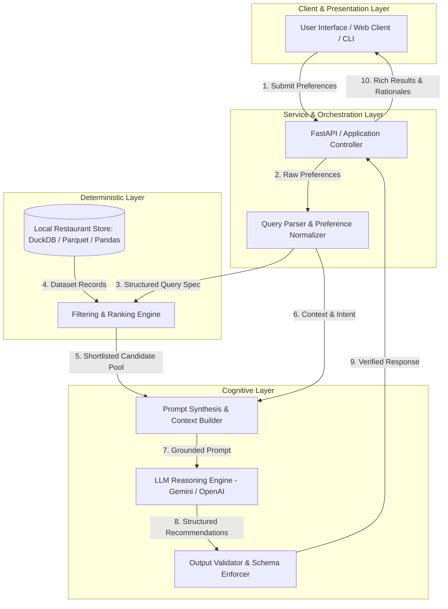
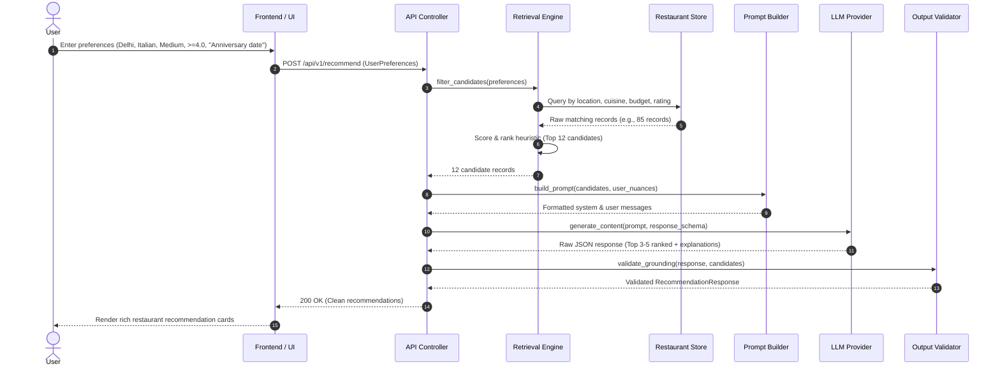

# System Architecture Specification: AI-Powered Restaurant Recommendation Engine

---

## 1. Executive Summary & Design Philosophy

The **AI-Powered Restaurant Recommendation Engine** is architectured around a **hybrid deterministic-semantic paradigm**. 

Rather than sending an entire unstructured catalog of restaurants into a Large Language Model (which is computationally prohibitive, slow, and prone to hallucinations), the system decouples **data retrieval** from **cognitive reasoning**:
1. **Deterministic Retrieval Layer:** Employs fast, rule-based filtering (SQL / Pandas / Vector Search) to slice through tabular restaurant data based on hard constraints (location, budget brackets, minimum rating, cuisine tags).
2. **Cognitive Reasoning Layer (LLM):** Ingests only the pruned, high-probability candidate pool (Top 10–15) alongside user subjective nuances (e.g., "romantic vibe", "family-friendly", "quick lunch") to evaluate trade-offs, rank the top choices, and synthesize human-like, grounded explanations.



---

## 2. Layered Architecture

The system is organized into five decoupled layers:

### 2.1 Presentation & Interface Layer
* **Responsibilities:**
  * Collects user preferences through interactive form controls (location dropdowns, budget sliders, multi-select cuisine pills, star ratings) and a free-form text input for subjective nuances.
  * Renders restaurant recommendation cards containing name, cuisine, rating, price tag, and AI reasoning.
* **Technology Options:** Streamlit (fast prototyping) or Next.js / Vanilla HTML/CSS/JS frontend communicating with a REST API.

---

### 2.2 Orchestration & Ingestion Layer
* **Dataset Ingestion Pipeline (`src/data/loader.py`):**
  * Fetches the Zomato dataset from Hugging Face ([`ManikaSaini/zomato-restaurant-recommendation`](https://huggingface.co/datasets/ManikaSaini/zomato-restaurant-recommendation)).
  * Runs an idempotent ETL job to clean data:
    * Standardizes column names (`restaurant_name`, `city`, `cuisines`, `cost_for_two`, `rating`, `votes`).
    * Strips extraneous formatting (e.g., `/5` in ratings, commas in currency strings).
    * Maps continuous cost into categorical buckets (`Low`: < ₹500, `Medium`: ₹500–₹1,500, `High`: > ₹1,500 for two).
    * Handles missing values (drops rows missing location or name; fills missing ratings with median).
  * Stores preprocessed data in memory-mapped Parquet or embedded DuckDB/SQLite for sub-millisecond querying.

* **Query Parser & Normalizer (`src/services/parser.py`):**
  * Validates user inputs against predefined Pydantic schemas.
  * Normalizes location and cuisine tokens (e.g., "café" $\rightarrow$ "cafe", "bengaluru" $\rightarrow$ "bangalore").

---

### 2.3 Deterministic Retrieval & Filtering Layer (`src/engine/filter.py`)
This layer prevents token bloat and hallucination by pre-selecting valid candidate restaurants:
1. **Hard Filtering:**
   * **Location Match:** Case-insensitive exact or substring match on `city` or `locality`.
   * **Rating Floor:** Filters restaurants where `rating >= user_min_rating`.
   * **Budget Filter:** Slices restaurants matching the requested budget category (`Low`, `Medium`, `High`) or a $\pm 20\%$ cost tolerance.
   * **Cuisine Match:** Checks for intersection between user-selected cuisines and restaurant cuisine tags.
2. **Graceful Fallback Algorithm:**
   * If hard filtering yields $< 3$ candidates, the engine systematically relaxes constraints in order:
     1. Expands budget boundary to adjacent tiers.
     2. Reduces minimum rating threshold by 0.5.
     3. Broadens cuisine match to general categories.
3. **Scoring & Candidate Pruning:**
   * Computes a baseline heuristic score for shortlisted records:
     $$\text{Score} = (\text{Rating} \times 0.7) + \left(\min\left(\frac{\text{Votes}}{1000}, 1.0\right) \times 0.3\right)$$
   * Selects Top $K$ ($K=10$ to $15$) highest-scoring records to pass to the cognitive layer.

---

### 2.4 Prompt Synthesis & Cognitive LLM Engine (`src/engine/recommender.py`)
* **Prompt Assembly (`src/prompts/templates.py`):**
  * Converts the Top $K$ candidates into a compact, token-optimized JSON array:
    ```json
    [
      {"id": 1, "name": "Toscano", "cuisine": "Italian", "rating": 4.5, "cost": 1500, "features": "Outdoor Seating, Wine"}
    ]
    ```
  * Injects system rules:
    * **Strict Grounding:** Must *only* select from provided candidates. No fabrication of restaurants or ratings.
    * **Nuance Alignment:** Match user free-text vibes (e.g., "quiet work spot", "date night") against restaurant features and cuisine profiles.
    * **Explainability:** For each selected restaurant, produce a 1–2 sentence contextual explanation connecting user desires with restaurant attributes.
* **LLM Provider Abstraction:**
  * Uses a unified client interface supporting Google Gemini (e.g., `gemini-1.5-pro` or `gemini-2.0-flash`) or OpenAI.
  * Enforces structured JSON output mode (via schema enforcement or instructor).

---

### 2.5 Validation & Response Delivery Layer
* **Schema Validation (`src/models/schema.py`):**
  * Validates the LLM output against a strict Pydantic model (`RecommendationResponse`).
  * Asserts that returned restaurant IDs match the retrieved candidate IDs (anti-hallucination check).
* **Delivery:** Emits the final recommendations with metadata and grounded rationales to the client.

---

## 3. End-to-End Sequence Diagram



---

## 4. Data Models & API Contracts

### 4.1 Input Schema (`UserPreferences`)

```python
from typing import List, Optional
from pydantic import BaseModel, Field

class UserPreferences(BaseModel):
    location: str = Field(..., description="Target city or locality (e.g., Bangalore, CP Delhi)")
    cuisines: List[str] = Field(..., min_items=1, description="Preferred cuisines (e.g., ['Italian', 'Continental'])")
    budget_tier: str = Field(..., regex="^(low|medium|high)$", description="Budget category")
    min_rating: float = Field(default=3.5, ge=1.0, le=5.0, description="Minimum star rating threshold")
    additional_notes: Optional[str] = Field(
        default=None, 
        description="Free-form subjective preferences (e.g., romantic dinner, pet-friendly, quiet work cafe)"
    )
    max_recommendations: int = Field(default=3, ge=1, le=5, description="Number of recommendations to return")
```

### 4.2 Candidate Record Schema (`RestaurantCandidate`)

```python
class RestaurantCandidate(BaseModel):
    restaurant_id: str
    name: str
    locality: str
    city: str
    cuisines: List[str]
    cost_for_two: int
    budget_tier: str
    rating: float
    votes: int
    highlights: Optional[List[str]] = []
```

### 4.3 Output Schema (`RecommendationResponse`)

```python
class RestaurantRecommendation(BaseModel):
    restaurant_id: str
    restaurant_name: str
    cuisine: str
    rating: float
    estimated_cost_for_two: str
    recommendation_reason: str = Field(
        ..., 
        description="Grounded explanation linking user context and restaurant attributes"
    )

class RecommendationResponse(BaseModel):
    query_summary: str
    total_candidates_analyzed: int
    recommendations: List[RestaurantRecommendation]
```

---

## 5. Directory & Codebase Layout

```
zomato-ai-recommender/
│
├── config/
│   ├── settings.py             # Environment variables, API keys, model hyperparameters
│   └── constants.py            # Budget thresholds, cuisine taxonomies
│
├── data/
│   ├── raw/                    # Cached raw Hugging Face dataset
│   └── processed/              # Parquet files containing clean, indexed restaurant data
│
├── src/
│   ├── data/
│   │   ├── __init__.py
│   │   ├── loader.py           # Hugging Face dataset download and caching
│   │   └── preprocessor.py     # ETL pipeline, data cleaning, budget categorization
│   │
│   ├── models/
│   │   ├── __init__.py
│   │   ├── schema.py           # Pydantic schemas (UserPreferences, Outputs)
│   │   └── restaurant.py       # Domain models
│   │
│   ├── engine/
│   │   ├── __init__.py
│   │   ├── filter.py           # Deterministic filtering, scoring & fallback logic
│   │   ├── prompt_builder.py   # Token-efficient prompt synthesis
│   │   └── recommender.py      # LLM invocation, schema enforcement & error handling
│   │
│   ├── api/
│   │   ├── __init__.py
│   │   ├── routes.py           # FastAPI endpoints
│   │   └── dependencies.py     # App singletons (dataset store, LLM client)
│   │
│   └── utils/
│       ├── logger.py           # Structured logging
│       └── metrics.py          # Latency & token counter
│
├── app.py                      # Main entrypoint (FastAPI / Streamlit)
├── requirements.txt            # Python dependencies
├── .env.example                # Sample environment variables
├── README.md                   # Setup and usage guide
└── Doc/
    ├── problemStatement.md     # Problem statement & business context
    └── architecture.md         # Detailed architectural design document
```

---

## 6. Prompt Engineering & Grounding Strategy

### System Prompt Specification
```markdown
You are an expert culinary concierge for an AI-powered Zomato recommendation service.
Your task is to recommend the best matching restaurants from a PRE-FILTERED list of candidates.

### STRICT OPERATING RULES:
1. ONLY recommend restaurants from the provided candidate list. Never invent or introduce outside restaurants.
2. Adhere strictly to the provided candidate attributes (ratings, cuisines, costs).
3. Evaluate the user's subjective preferences (ambiance, occasion, dietary nuances) against each candidate's features and culinary profile.
4. Provide a personalized rationale for each recommendation explaining precisely why it satisfies the user's explicit criteria and subjective intent.
5. Return your response exclusively formatted according to the required JSON schema.
```

### Injected Candidate Representation
```json
Candidates:
[
  {
    "id": "R001",
    "name": "The Big Chill Cafe",
    "cuisines": ["Italian", "Continental", "Desserts"],
    "rating": 4.6,
    "cost_for_two": 1500,
    "budget": "medium",
    "locality": "Khan Market, Delhi"
  },
  ...
]
```

---

## 7. Non-Functional Specifications & Guardrails

| Dimension | Target Specification | Implementation Mechanism |
| :--- | :--- | :--- |
| **End-to-End Latency** | $< 2.5$ seconds | In-memory candidate pre-filtering ($< 50\text{ms}$) + Fast LLM generation ($< 2\text{s}$). |
| **Token Optimization** | $< 1,500$ tokens per inference | Compact JSON candidate representation; limiting pool size to $10 \le K \le 15$. |
| **Hallucination Prevention** | $0\%$ ungrounded restaurants | Candidate ID cross-validation in `src/engine/recommender.py`. |
| **Scalability & Cost** | Minimal API costs | Deterministic layer rejects non-matching queries before reaching LLM; cached popular searches. |
| **Security & Privacy** | OWASP Top 10 for LLMs | Input sanitization against prompt injection in `additional_notes`; API keys isolated in `.env`. |

---

## 8. Development & Deployment Roadmap

1. **Sprint 1: Data Pipeline & Baseline Engine**
   - Implement `loader.py` to pull and cache Hugging Face dataset.
   - Implement `preprocessor.py` for cleaning, normalization, and categorical budget tagging.
   - Build `filter.py` with multi-attribute filtering and scoring.
2. **Sprint 2: LLM Integration & Structured Extraction**
   - Configure LLM client with structured JSON outputs.
   - Implement `prompt_builder.py` with anti-hallucination guardrails.
   - Build unit tests validating schema conformity and candidate verification.
3. **Sprint 3: API & User Interface**
   - Expose FastAPI `/recommend` endpoint.
   - Build an interactive UI (Streamlit or modern web app) with dynamic filter selectors.
4. **Sprint 4: Evaluation & Hardening**
   - Benchmark recommendation quality across diverse scenarios (edge cases: zero results, obscure cuisines).
   - Add telemetry for latency and token monitoring.
