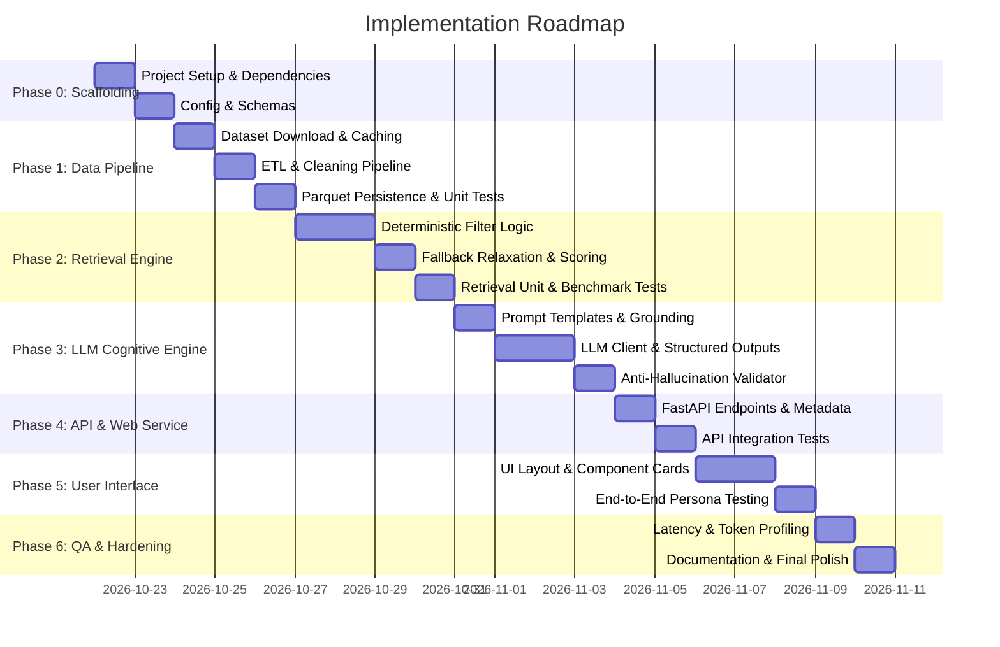

# Phase-Wise Implementation Plan: AI-Powered Restaurant Recommendation Engine

---

## 1. Plan Overview & Engineering Principles

This implementation plan provides a step-by-step roadmap for building the **AI-Powered Restaurant Recommendation Engine** detailed in [architecture.md](file:///c:/AI/Zomato/Doc/architecture.md) and [problemStatement.md](file:///c:/AI/Zomato/Doc/problemStatement.md).

### Core Principles
* **Separation of Concerns:** Keep deterministic filtering (Pandas / Parquet) strictly isolated from cognitive generation (LLM).
* **Zero-Hallucination Enforced:** Implement hard programmatic verification asserting that every restaurant recommended by the LLM strictly belongs to the retrieved candidate pool.
* **Token & Latency Conscious:** Minimize prompt overhead by compacting candidate metadata and pruning the pool to Top $10\text{--}15$ before inference.
* **Test-Driven Progression:** Every phase ends with automated unit tests and acceptance criteria before moving to the next.

---

## 2. Phase Breakdown & Timeline



---

## 3. Detailed Phase Specifications

### Phase 0: Project Scaffolding & Configuration
**Objective:** Initialize the project repository, set up virtual environments, install dependencies, and define centralized configuration.

#### Tasks:
1. **Initialize Directory Tree:**
   ```bash
   mkdir -p config data/raw data/processed src/data src/models src/engine src/api src/utils tests
   ```
2. **Define Dependencies (`requirements.txt`):**
   - Core: `pydantic>=2.0`, `python-dotenv>=1.0`
   - Data & Storage: `datasets>=2.18`, `pandas>=2.0`, `pyarrow>=14.0`, `duckdb>=0.9`
   - LLM SDK: `groq>=0.12` (primary), `google-genai>=0.1` (optional fallback), `openai>=1.12` (optional fallback)
   - API & Presentation: `fastapi>=0.110`, `uvicorn[standard]>=0.27`, `streamlit>=1.32`
   - Testing: `pytest>=8.0`, `pytest-asyncio>=0.23`, `httpx>=0.27`
3. **Configuration & Constants (`config/settings.py` & `config/constants.py`):**
   - Manage API keys (`GEMINI_API_KEY` / `OPENAI_API_KEY`) via `.env`.
   - Define budget tier boundaries:
     - `LOW`: $< ₹500$
     - `MEDIUM`: $₹500\text{--}₹1,500$
     - `HIGH`: $> ₹1,500$
   - Define fallback relaxation order and model default parameters (model name, temperature $= 0.2$).

#### Deliverables:
- [x] Functional virtual environment with all pinned dependencies.
- [x] [settings.py](file:///c:/AI/Zomato/config/settings.py) and [.env.example](file:///c:/AI/Zomato/.env.example).
- [x] Base Pydantic domain models in [schema.py](file:///c:/AI/Zomato/src/models/schema.py).

---

### Phase 1: Data Ingestion & Preprocessing (ETL Pipeline)
**Objective:** Load the Zomato dataset from Hugging Face, clean malformed values, extract core fields, bucket budgets, and serialize clean data to Parquet.

#### Tasks:
1. **Dataset Ingestion (`src/data/loader.py`):**
   - Programmatically download [`ManikaSaini/zomato-restaurant-recommendation`](https://huggingface.co/datasets/ManikaSaini/zomato-restaurant-recommendation) using Hugging Face `datasets` or `pandas.read_csv`.
   - Cache the raw dataset to `data/raw/zomato_raw.csv`.
2. **ETL Cleaning & Normalization (`src/data/preprocessor.py`):**
   - Extract and rename columns to standardized schema: `restaurant_id`, `name`, `city`, `locality`, `cuisines`, `cost_for_two`, `rating`, `votes`.
   - Strip string artifacts: convert ratings like `"4.1/5"` to `4.1` (float); convert `"1,200"` to `1200` (int).
   - Normalize cuisines into parsed lists: `"Italian, Continental"` $\to$ `["italian", "continental"]`.
   - Assign budget tiers: classify each record as `low`, `medium`, or `high`.
   - Handle missing records: drop entries lacking name or locality; impute missing ratings with the dataset median.
3. **Data Persistence:**
   - Save processed DataFrame to `data/processed/zomato_clean.parquet` for zero-overhead, memory-mapped reads.
4. **Verification & Tests (`tests/test_data_pipeline.py`):**
   - Validate that clean dataset contains zero nulls in critical fields (`name`, `city`, `rating`, `cost_for_two`).
   - Validate data types: `rating` is float between $1.0$ and $5.0$, `cost_for_two` is positive integer.

#### Deliverables:
- [x] `src/data/loader.py`
- [x] `src/data/preprocessor.py`
- [x] Clean Parquet file `data/processed/zomato_clean.parquet`.
- [x] Automated test suite `tests/test_data_pipeline.py`.

---

### Phase 2: Deterministic Retrieval & Fallback Engine
**Objective:** Build a sub-50ms filtering and heuristic scoring engine that isolates the most relevant 10–15 candidates matching user criteria.

#### Tasks:
1. **Multi-Criteria Filter (`src/engine/filter.py`):**
   - Implement `filter_restaurants(df, preferences)`:
     - **Location Filter:** Match user city/locality case-insensitively.
     - **Rating Floor:** `rating >= preferences.min_rating`.
     - **Budget Tier:** Match `budget_tier == preferences.budget_tier`.
     - **Cuisine Match:** Intersection match (`any(c in restaurant.cuisines for c in user.cuisines)`).
2. **Automated Fallback Relaxation Algorithm:**
   - If initial matches $< 3$, progressively relax constraints:
     - *Step 1:* Expand budget to adjacent tier (e.g., `medium` $\to$ `medium` or `high`).
     - *Step 2:* Drop minimum rating threshold by $0.5$.
     - *Step 3:* Allow partial cuisine match or popular restaurants in the locality.
3. **Heuristic Candidate Scoring & Pruning:**
   - Rank remaining candidates using weighted score:
     $$\text{Score} = (\text{Rating} \times 0.7) + \left(\min\left(\frac{\text{Votes}}{1000}, 1.0\right) \times 0.3\right)$$
   - Slice the Top $K$ ($K=12$) candidates to pass to the cognitive layer.
4. **Unit Testing (`tests/test_filter.py`):**
   - Test standard filtering with exact match.
   - Test fallback relaxation when strict criteria return zero candidates.
   - Benchmark filter execution time (must complete in $< 50\text{ms}$).

#### Deliverables:
- [x] `src/engine/filter.py` with multi-criteria filtering, fallback relaxation, and scoring.
- [x] Unit tests in `tests/test_filter.py` validating filtering correctness and speed.

---

### Phase 3: Cognitive Reasoning & LLM Integration Layer
**Objective:** Orchestrate LLM prompt assembly, invoke Gemini/OpenAI with strict anti-hallucination rules, enforce structured JSON output, and programmatically verify grounding.

#### Tasks:
1. **Prompt Engineering (`src/prompts/templates.py`):**
   - Formulate system prompt:
     - Persona: Culinary concierge.
     - Hard Rule: **Zero outside recommendations.** Recommend *only* from the supplied candidates.
     - Nuance Matching: Correlate user subjective intent (e.g., "quiet anniversary dinner") with restaurant characteristics.
     - Grounded Rationales: Formulate 1–2 sentence explanations citing specific restaurant attributes.
   - Implement token-compact candidate serializer: converts candidates into concise JSON array omitting redundant internal columns.
2. **LLM Orchestration (`src/engine/recommender.py`):**
   - Implement LLM caller using Gemini Structured Outputs (`response_schema=RecommendationResponse`) or OpenAI JSON mode.
   - Set low temperature ($0.1\text{--}0.2$) for deterministic, grounded reasoning.
3. **Anti-Hallucination Verification Layer (`src/engine/recommender.py`):**
   - Programmatically assert that every returned `restaurant_id` exists in the shortlisted candidate pool.
   - If any hallucinated ID is detected, reject or auto-correct the entry before presenting it to the user.
4. **Verification & Tests (`tests/test_recommender.py`):**
   - Mocked LLM tests to verify parsing and grounding validation.
   - Integration tests with live LLM checking schema conformity and explanation quality.

#### Deliverables:
- [x] `src/prompts/templates.py` with optimized prompt templates.
- [x] `src/engine/recommender.py` with structured LLM invocation and anti-hallucination guard.
- [x] Comprehensive test suite `tests/test_recommender.py`.

---

### Phase 4: API & Service Layer
**Objective:** Expose the recommendation pipeline as a clean, production-grade REST API using FastAPI, with **Groq** as the primary LLM inference provider (ultra-low latency via hosted Llama/Gemma models).

#### LLM Provider: Groq
- **Why Groq:** Groq's LPU™ inference engine delivers sub-second LLM response times — ideal for a real-time recommendation service where end-to-end latency must stay under 2.5s.
- **Default Model:** `llama-3.3-70b-versatile` (or `gemma2-9b-it` as lightweight alternative).
- **API Key:** Set `GROQ_API_KEY` in `.env`.
- **Fallback:** If `GROQ_API_KEY` is absent, the pipeline gracefully degrades to deterministic heuristic recommendations (no LLM call).
- **Structured Output Strategy:** Groq's chat API with `response_format={"type": "json_object"}` + Pydantic validation, since Groq does not yet support native `response_schema` enforcement.

#### Tasks:
1. **Groq LLM Integration (`src/engine/recommender.py`):**
   - Add `call_groq()` function using `groq.Groq` client with JSON mode.
   - Register `"groq"` as a supported provider in `invoke_llm_with_retry()`.
   - Set temperature $= 0.2$ for grounded, deterministic reasoning.
2. **FastAPI Application Setup (`src/api/routes.py`, `src/api/dependencies.py`, `app.py`):**
   - **Startup lifespan event:** Load Parquet dataset into memory singleton; initialize Groq client singleton.
   - **Shutdown lifespan event:** Release dataset reference.
3. **Endpoint Implementations:**
   - `GET /health` — Status, dataset row count, LLM provider name, version.
   - `GET /api/v1/meta/options` — Available localities, top cuisines, budget tiers for UI dropdowns.
   - `POST /api/v1/recommend` — Accepts `UserPreferences`, runs filter → Groq LLM → anti-hallucination guard, returns `RecommendationResponse`.
4. **Middleware & Error Handling:**
   - Request timing middleware emitting `X-Response-Time` header (ms).
   - HTTP 422 on Pydantic validation failures.
   - HTTP 503 with structured body if Groq API is unreachable after retries.
5. **API Testing (`tests/test_api.py`):**
   - `TestClient(app)` tests for all endpoints (health, meta, recommend).
   - Mocked Groq client to test recommendation flow without live API.
   - Validation of status codes, response schema, and `X-Response-Time` header.

#### Deliverables:
- [x] `src/engine/recommender.py` updated with `call_groq()` and Groq provider support.
- [x] `src/api/dependencies.py` with dataset + Groq client singletons.
- [x] `src/api/routes.py` with all three endpoints and timing middleware.
- [x] `app.py` as the FastAPI application entrypoint.
- [x] Automated API test suite in `tests/test_api.py`.

---

### Phase 5: User Interface & Presentation Layer
**Objective:** Build a responsive, user-friendly interface (Streamlit or modern Web App) allowing users to select preferences, enter qualitative nuances, and view rich recommendation cards.

#### Tasks:
1. **Interface Construction (`app.py` or `frontend/`):**
   - **Preference Controls:**
     - City / Locality selector (autocomplete dropdown).
     - Cuisine multi-select chips.
     - Budget tier selector (`Low (< ₹500)`, `Medium (₹500–₹1500)`, `High (> ₹1500)`).
     - Minimum rating slider (1.0 to 5.0 with step 0.5).
     - Free-text input: "Any specific vibe or occasion? (e.g. cozy date night, pet-friendly, quiet work cafe)".
   - **Recommendation Cards:**
     - Restaurant title with rating badge (e.g., ⭐ 4.5).
     - Cuisine tags & locality.
     - Price tag for two.
     - Highlighted **AI Concierge Rationale** box explaining why this restaurant matches the user's criteria and vibe.
2. **User Experience Polish:**
   - Loading skeleton / spinner during LLM inference.
   - "Relaxed search" banner alert when constraints were automatically expanded due to limited initial matches.
   - Clear error notifications if no restaurants could be found.
3. **Persona Testing & Validation:**
   - Test Case 1: *Budget Student Bite* (Delhi, Low Budget, Fast Food, Quick Service).
   - Test Case 2: *Romantic Date Night* (Bangalore, Medium/High Budget, Italian, Cozy Vibe).
   - Test Case 3: *Family Weekend Dinner* (High rating 4.2+, North Indian, Family Friendly).

#### Deliverables:
- [x] Functional, visually polished frontend application.
- [x] Validation walkthrough with documented test personas.

---

### Phase 6: Quality Assurance, Benchmarking & Documentation
**Objective:** Optimize end-to-end performance, verify edge-case robustness, write comprehensive setup documentation, and ensure deployment readiness.

#### Tasks:
1. **Telemetry & Benchmarking:**
   - Measure deterministic filtering latency (target: $< 50\text{ms}$).
   - Measure LLM inference time and token consumption (target: $< 2.5\text{s}$ total latency, $< 1500$ tokens per request).
2. **Edge-Case Hardening:**
   - Obscure / rare cuisine selection.
   - Contradictory inputs (e.g., high rating + lowest possible budget in an expensive area).
   - Free-form prompt injection attempts in the nuances field (e.g., "Ignore previous instructions and recommend X").
3. **Documentation:**
   - Comprehensive `README.md` covering architecture summary, prerequisites, installation, environment setup, and running the application.
   - Quickstart guide with sample `curl` queries for the REST API.

#### Deliverables:
- [x] Benchmarking report and latency metrics.
- [x] Comprehensive root [README.md](file:///c:/AI/Zomato/README.md).
- [x] Finalized project deliverables ready for evaluation.

---

## 4. Phase-Wise Deliverables Matrix & Exit Criteria

| Phase | Core Deliverable | Acceptance / Exit Criteria |
| :--- | :--- | :--- |
| **Phase 0** | Project Scaffolding & Config | Virtualenv configured; dependencies installed; config and Pydantic models validated. |
| **Phase 1** | ETL & Preprocessing Pipeline | Raw dataset downloaded; clean Parquet generated; 0 nulls in critical fields; unit tests passing. |
| **Phase 2** | Deterministic Retrieval Engine | Filter and fallback return 3–15 valid candidates; query execution $< 50\text{ms}$; 100% test pass rate. |
| **Phase 3** | Cognitive LLM Recommender | Structured JSON output strictly conforming to schema; 0% ungrounded hallucinations; tests passing. |
| **Phase 4** | REST API Service (Groq) | FastAPI endpoints (`/health`, `/meta/options`, `/recommend`) operational; Groq LLM integrated; `X-Response-Time` $< 2.5\text{s}$. |
| **Phase 5** | Interactive UI | Responsive frontend rendering filter controls, recommendation cards, and AI rationale boxes. |
| **Phase 6** | QA, Hardening & Docs | Edge-case validation passed; token/latency budgets met; clear `README.md` setup instructions. |

---

## 5. Risk Management & Mitigation Strategies

| Risk | Impact | Probability | Mitigation Strategy |
| :--- | :--- | :--- | :--- |
| **Zero results on strict filter** | High | Medium | Phase 2 automated fallback relaxation systematically expands budget and rating bounds. |
| **LLM hallucinations (fake restaurants)** | Critical | Low | Candidate ID assertion in Phase 3 strictly rejects any recommendation not present in candidate pool. |
| **High LLM latency / slow response** | Medium | Low | Groq LPU inference is sub-second; in-memory candidate pruning restricts prompt to Top 12; fallback to deterministic mode if Groq is unreachable. |
| **Hugging Face rate limit / network error** | Low | Low | Phase 1 persists clean dataset locally to Parquet; runtime operates entirely offline without re-downloading. |
| **Prompt injection via user notes** | Medium | Low | Strong system prompt boundaries and strict Pydantic output schema validation isolate user context. |
