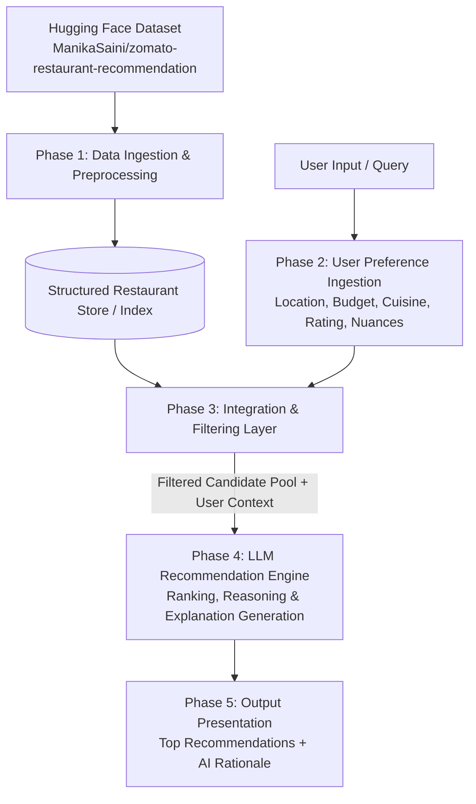

# Problem Statement: AI-Powered Restaurant Recommendation System (Zomato Use Case)

---

## 1. Project Overview & Context

In modern food discovery and delivery ecosystems like **Zomato**, users often struggle to find restaurants that perfectly match both their hard constraints (location, budget, cuisine, dietary preferences) and subjective, nuanced desires (e.g., "a quiet spot for a team lunch," "authentic sourdough pizza on a budget," or "family-friendly dining with outdoor seating").

Traditional recommendation engines primarily rely on rigid keyword searches and static attribute filters. While these filters narrow down options, they cannot reason over trade-offs, interpret fuzzy or contextual user preferences, or explain *why* a particular restaurant is the ideal match for an occasion.

This project focuses on designing and implementing an **AI-Powered Restaurant Recommendation System** inspired by Zomato. By pairing real-world structured restaurant datasets with the semantic reasoning and natural language generation of a **Large Language Model (LLM)**, the system delivers personalized, context-aware, and human-like recommendations with clear, grounded rationales.

---

## 2. Core Objectives

The goal is to engineer an end-to-end intelligent recommendation service that:

1. **Captures Comprehensive User Preferences:** Ingests both structured criteria (location, budget range, cuisine, minimum rating) and unstructured intent (vibe, occasion, dietary restrictions).
2. **Utilizes Real-World Industry Data:** Preprocesses and indexes real-world restaurant data sourced from Hugging Face ([`ManikaSaini/zomato-restaurant-recommendation`](https://huggingface.co/datasets/ManikaSaini/zomato-restaurant-recommendation)).
3. **Implements an Intelligent Integration & Filtering Pipeline:** Performs candidate retrieval via structured filtering, optimizing token consumption and context windows before passing data to the LLM.
4. **Leverages LLM for Ranking & Explainability:** Employs an LLM to evaluate candidate restaurants against user constraints, rank the top choices, and generate transparent explanations for each recommendation.
5. **Delivers User-Centric, Structured Results:** Presents top recommendations with critical attributes (Name, Cuisine, Rating, Estimated Cost, and AI-generated explanations) in an intuitive format.

---

## 3. System Architecture & Workflow

The recommendation lifecycle follows a 5-stage pipeline:



### Detailed Pipeline Breakdown

### Phase 1: Data Ingestion & Preprocessing
* **Dataset Source:** Hugging Face repository [`ManikaSaini/zomato-restaurant-recommendation`](https://huggingface.co/datasets/ManikaSaini/zomato-restaurant-recommendation).
* **Attribute Extraction:**
  * `Restaurant Name`: Identifier of the establishment.
  * `City / Locality / Address`: Geographic coordinates and locality information.
  * `Cuisines`: Primary and secondary cuisines offered (comma-separated or list).
  * `Average Cost for Two / Price Range`: Numerical or tiered pricing (Low, Medium, High).
  * `Aggregate Rating & Rating Text`: Numerical score (e.g., 1.0–5.0) and descriptive sentiments (e.g., "Excellent", "Very Good").
  * `Votes`: Popularity metric.
  * `Highlights / Features` (if available): Online delivery, table reservation, veg-friendly, etc.
* **Cleaning & Normalization:**
  * Handling null, missing, or malformed values.
  * Normalizing budget classifications to map intuitive user tiers (`low`, `medium`, `high`) to dataset cost ranges.
  * Text standardisation on cuisines and locations for case-insensitive matching.

---

### Phase 2: User Preference Acquisition
The system gathers structured inputs and optional qualitative constraints:

| Preference Dimension | Examples / Format | Classification |
| :--- | :--- | :--- |
| **Location** | Delhi, Bangalore, Connaught Place, Indiranagar | Hard Filter |
| **Budget** | Low (< ₹500), Medium (₹500 - ₹1500), High (> ₹1500) | Hard / Flexible Filter |
| **Cuisine** | Italian, North Indian, Chinese, Continental, Cafe | Hard Filter |
| **Minimum Rating** | 3.5+, 4.0+, 4.5+ | Quality Floor |
| **Contextual Nuances** | "Family-friendly", "romantic date night", "quick bite", "late-night open" | Soft Semantic Modifier |

---

### Phase 3: Integration & Filtering Layer
To prevent token bloat and reduce LLM inference costs:
* **Candidate Retrieval (Pre-filtering):** Query the structured dataset against user hard criteria (e.g., `City == "Bangalore"`, `Cuisine contains "Italian"`, `Rating >= 4.0`).
* **Candidate Pool Pruning:** Select top $N$ candidate candidates (e.g., top 10–20 based on a hybrid score of rating and vote volume).
* **Prompt Assembly:** Format the shortlisted restaurant metadata into a concise, token-efficient JSON or tabular schema to inject into the LLM system/user prompt.

---

### Phase 4: Recommendation & Ranking Engine (LLM Layer)
The LLM serves as the cognitive reasoning engine:
* **Constraint Reasoning:** Evaluates user nuances (e.g., matching a "cozy quiet spot" against restaurant types like cafes or bistros).
* **Relative Ranking:** Ranks the top 3–5 matching restaurants from the candidate set.
* **Explainability (Grounding):** Generates concise, personalized rationales highlighting why each establishment fits the user's explicit and implicit needs, strictly grounded in the ingested attributes (avoiding hallucinations).

---

### Phase 5: Output & Presentation
Presents recommendations in a structured, actionable format:

```json
[
  {
    "restaurant_name": "Toscano",
    "cuisine": "Italian, Continental, Desserts",
    "rating": 4.5,
    "cost_for_two": "₹1,500 (Medium-High)",
    "recommendation_reason": "Ideal for your Italian preference with high-rated artisanal pastas and a relaxed ambiance that fits your evening dinner request."
  }
]
```

---

## 4. Key Requirements & Success Criteria

### Functional Requirements
- [x] **Deterministic Filtering:** Strict adherence to geographical and rating boundaries.
- [x] **Zero Hallucination Guarantee:** The LLM must recommend *only* restaurants present in the ingested dataset candidates.
- [x] **Dynamic Personalization:** Recommendation explanations must reference the user's specific query parameters rather than generic praise.
- [x] **Configurable Prompt Templates:** Support easily swappable prompts for testing different ranking personas and output schemas.

### Non-Functional Requirements
- **Performance & Latency:** Retrieval and pre-filtering executed in sub-second time; prompt sizes scoped to optimize LLM time-to-first-token (TTFT).
- **Cost Efficiency:** Pre-filtering avoids dumping the entire dataset into the LLM context, keeping token usage under budget.
- **Robust Error Handling:** Graceful fallbacks when zero restaurants match strict criteria (e.g., widening budget or suggesting nearby cuisines).

---

## 5. Scope & Future Extensions

> [!NOTE]
> **MVP Scope:**
> Ingestion of the Hugging Face Zomato dataset, rule-based pre-filtering layer, structured prompt construction, LLM ranking & explanation generation, and CLI / web response display.

> [!TIP]
> **Future Roadmap Possibilities:**
> - **Conversational Assistant:** Multi-turn dialogue for interactive preference refinement.
> - **Retrieval-Augmented Generation (RAG) with User Reviews:** Ingesting full customer reviews into a vector database (e.g., Chroma / FAISS) for deeper semantic sentiment matching.
> - **Geo-Spatial Search:** Radius-based distance calculation using exact GPS coordinates.
> - **Multi-modal Support:** Displaying restaurant dish images and menu cards.
